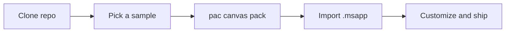

<div align="center">

# 🎨 Power Apps Canvas Samples

**Sanitized, reusable Canvas App samples and Power Fx patterns from real-world projects.**


</div>

---

## ✨ What's Inside

| 📁 Folder | 📝 Contents |
|---|---|
| `samples/` | Unpacked Canvas Apps, ready to import |
| `patterns/` | Power Fx techniques: delegation, collections, error handling |
| `components/` | Reusable component library |
| `docs/` | Screenshots and guides |

## 🔄 How It Works



## 🗺️ Roadmap

- [x] Create repository
- [ ] Starter CRUD app
- [ ] Delegation patterns
- [ ] Error handling with `IfError`
- [ ] Reusable components
- [ ] Responsive layout sample

## 🚀 Quick Start

```bash
git clone https://github.com/bharadwaj-vemula/power-apps-canvas-samples.git
pac canvas pack --sources ./samples/01-starter-app --msapp ./app.msapp
```

> 🔒 All samples are sanitized: no client data, tenant IDs, or secrets.

---

<div align="center">

Built by **[Bharadwaj Vemula](https://github.com/bharadwaj-vemula)** · Microsoft Power Platform Developer

</div>
