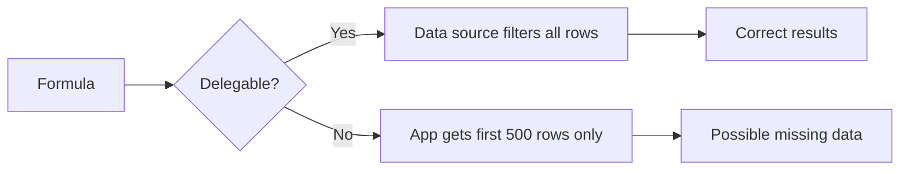

# 🎯 Delegation in Power Apps

**Make sure your app queries the whole data source, not just the first few hundred rows.**

---

## 🧠 What Is Delegation?

When a formula is **delegable**, Power Apps sends the work to the data source (SharePoint, Dataverse, SQL) and gets back only the matching rows.

When it is **not delegable**, Power Apps downloads a limited set of rows and processes them locally. Rows beyond that limit are silently ignored, which causes wrong results on large lists.

## ⚠️ The Data Row Limit

- Default: **500 rows**
- Maximum: **2,000 rows**
- Change it at: **Settings → General → Data row limit**

Raising the limit is a workaround, not a fix. Prefer delegable formulas.

## 🚦 Spot the Problem

A **blue underline** on a formula means a delegation warning. Hover over it to see which part is not delegable.

## ✅ Delegable vs ❌ Not Delegable

| Goal | ✅ Delegable pattern | ❌ Risky pattern |
|---|---|---|
| Filter by value | `Filter(Orders, Status = "Open")` | `Filter(Orders, Lower(Status) = "open")` |
| Text search | `Filter(Orders, StartsWith(Title, txtSearch.Text))` | `Filter(Orders, txtSearch.Text in Title)` on SharePoint |
| Sort | `SortByColumns(Orders, "Created", SortOrder.Descending)` | Sorting on a calculated expression |
| Single record | `LookUp(Orders, ID = varID)` | `First(Orders)` after a non-delegable filter |

> 💡 Support depends on the data source. Dataverse delegates more functions than SharePoint, so always check the Microsoft docs for your connector.

## 🧰 Workarounds

1. **Filter first** with a delegable condition, then apply other logic to the smaller result.
2. **Use `StartsWith`** instead of `in` or `Search` for SharePoint text search.
3. **Add a helper column** (for example a lowercase copy of a text field) so you can filter on it directly.
4. **Use Dataverse** when you need richer delegation support.
5. **Use a flow** to return filtered data for very complex queries.

## 📋 Checklist Before You Ship

- [ ] No blue delegation warnings left in galleries and forms
- [ ] Tested with more rows than the data row limit
- [ ] Data row limit documented in the app notes
- [ ] Search and filter controls use delegable functions

---

Built by **[Bharadwaj Vemula](https://github.com/bharadwaj-vemula)** · Microsoft Power Platform Developer

