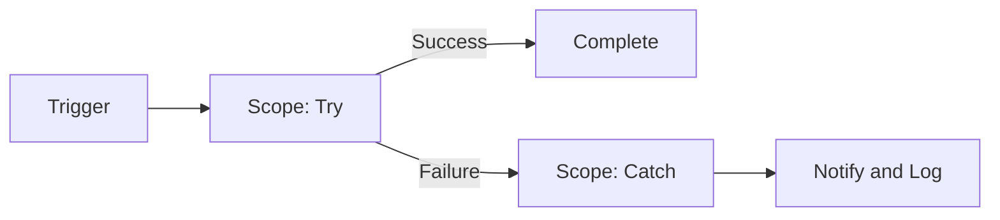

# ⚡ Power Automate Flow Patterns

**Battle-tested, reusable flow patterns for reliable automation.**

---

## ✨ Patterns

| 🧩 Pattern | 📝 Use it when |
|---|---|
| Error handling with Scopes | You need try/catch/finally behavior |
| Retry policies | Calls to APIs fail intermittently |
| Child flows | Logic is reused across flows |
| Approvals | A human must sign off before the flow continues |
| Pagination and batching | You are handling large datasets |

## 🔄 Standard Flow Shape

## 🗺️ Roadmap

- [x] Create repository
- [ ] Error handling with Scopes
- [ ] Retry and timeout settings
- [ ] Child flow template
- [ ] Approval pattern
- [ ] Pagination and batch operations

> 🔒 All patterns are sanitized: no client data, tenant IDs, or secrets.

---

Built by **[Bharadwaj Vemula](https://github.com/bharadwaj-vemula)** · Microsoft Power Platform Developer

